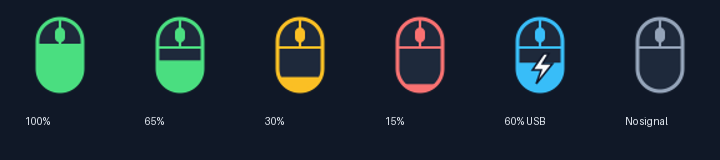

# Mouse Battery for Monster Pusat

A small Linux battery reader and desktop indicator for a Monster Pusat mouse
using the **Compx `260d:1074` 2.4 GHz USB receiver**.

[Türkçe](README.tr.md) · [Protocol notes](docs/protocol.md) · [Contributing](CONTRIBUTING.md) · [MIT license](LICENSE)



The indicator displays the receiver's battery percentage, a mouse-shaped level
icon, cable status, and the last successful reading. It runs in the background,
refreshes every five seconds, and warns below 20% when the cable is disconnected.
The terminal reader works independently of the desktop indicator.

This is an unofficial community project, not a Monster product or driver.
It does not add a device to GNOME Settings / UPower's battery list.
The application currently uses Turkish menu labels and diagnostic messages.

## Compatibility

**Verified environment:** Ubuntu **26.04.1 LTS**, GNOME, x86_64, Python 3.14.4,
and one physical Monster Pusat mouse with receiver ID `260d:1074`.
The exact retail model name and firmware revision have not been recorded.
Brand name alone does not establish compatibility.

| Component / environment | Status |
| --- | --- |
| Battery queries and desktop indicator on the environment above | Tested on real hardware |
| Other Ubuntu releases and Debian-based distributions | Not tested; the installer requires `apt-get` and udev |
| Fedora, Arch, openSUSE, and other Linux distributions | Not tested; manual dependency and permission setup required |
| Other desktop environments | Not tested; the indicator needs an AppIndicator / StatusNotifier host |
| Other architectures | Not tested; HID ioctl constants need verification |
| Bluetooth, other USB IDs, or other Pusat models | Not supported by the current device-discovery code |
| Windows and macOS | Not supported; the reader uses Linux hidraw and sysfs |

It is **not verified on every Linux distribution**. The reader depends on
Linux's [hidraw interface](https://docs.kernel.org/hid/hidraw.html), the matching
receiver, and read/write access to its device node. Desktop integration additionally
requires GTK 3, Ayatana AppIndicator, and a compatible tray host. On GNOME,
[AppIndicator support](https://github.com/ubuntu/gnome-shell-extension-appindicator)
must be installed and enabled. Package availability alone is not a compatibility test.

## Install on Ubuntu / apt-based systems

From your normal desktop user's terminal, inside this repository:

```bash
sudo bash install.sh
/usr/bin/python3 mouse_tray.py
```

The installer:

1. Installs the system Python GI bindings, GTK 3, Ayatana AppIndicator, SVG loader,
   and `notify-send`.
2. Installs `70-mouse-battery.rules` and reloads hidraw rules.
3. Adds an autostart entry for the user who invoked `sudo`.
4. Tries a battery query without root privileges.

Keep the repository at its installed location: the autostart entry points to
`mouse_tray.py` there. Run the installer again after moving the directory.
If the icon does not appear, enable your desktop's AppIndicator support and
unplug/replug the receiver. The installer does not install a GNOME extension.

Use the **system Python** for the indicator. A virtual environment may not see
the distribution's `gi` bindings. Python 3.9+ is required by the code; versions
other than the verified one above have not been tested locally.

The application does not use `.env`, credentials, network APIs, or a root password.
Root is needed for system installation, not for normal operation.

## Other Linux distributions: manual setup

The included installer is not a universal Linux installer. Install the following
capabilities using your distribution's package manager; package names vary:

- Python 3.9+; the terminal reader uses only its standard library.
- For the indicator: PyGObject (`gi`), GTK 3 introspection data,
  AyatanaAppIndicator3 0.1, GdkPixbuf, and an SVG loader such as librsvg.
- For notifications: `notify-send` and a desktop notification service.
- For tray integration: an AppIndicator / StatusNotifier host in your desktop.

On a system using **udev and logind**, install the supplied permission rule:

```bash
sudo install -m 0644 70-mouse-battery.rules /etc/udev/rules.d/70-mouse-battery.rules
sudo udevadm control --reload-rules
```

Then unplug/replug the receiver and run the terminal query below. The rule grants
access to the active local session through `uaccess`; it does not depend on a
`plugdev` group. Systems without that session/permission mechanism require an
administrator-provided equivalent. Do not make all hidraw devices world-writable.

Start the indicator manually with your distribution's system Python. To enable
autostart, add that command to your desktop's startup applications using the
**absolute path** to `mouse_tray.py`. This manual path has not been tested on
other distributions; please report results with the environment details.

## Usage

```bash
# One reading; no GTK dependencies needed
python3 mouse_battery.py

# Include the raw 17-byte reply
python3 mouse_battery.py --raw

# Watch every five seconds; Ctrl+C to stop
python3 mouse_battery.py --watch 5

# Desktop indicator; run as your normal user
/usr/bin/python3 mouse_tray.py
```

| Indicator | Meaning |
| --- | --- |
| Green mouse | 40–100% |
| Yellow mouse | 20–39% |
| Red mouse | Below 20% |
| Blue mouse + lightning | Receiver reports a connected cable |
| Gray mouse + `—` | No valid current battery reading |

The mouse fill follows the battery percentage. Cable changes are shown on the
next successful poll, normally within roughly five seconds, plus query time.
The lightning icon means **cable connected**, not independently verified active
charging. A large percentage jump within the same connection mode triggers one
additional reading after three seconds. USB reads run outside the GTK thread;
only one query is in flight at a time. A second indicator instance exits.

Open the menu for connection details, last reading time, **Şimdi yenile**
(refresh now), or **Kapat** (quit). Low-battery notifications repeat at most once
every ten minutes while continuously below the threshold and disconnected.

## Known device behavior

On the tested mouse, plugging in the cable repeatedly changed the reported level
from **100% to 95%**; unplugging changed it back to **100%**. Both reports had valid
checksums and remained stable across repeated reads. The application displays
these device-reported values without applying a made-up correction.

The observed voltage field is zero, so it does not provide an independent way
to determine the true charge level. See [the captured reports](docs/protocol.md).
Receiver unplug/replug recovery is covered by mocked tests; cable removal was
also observed on real hardware. Other firmware formats are not assumed compatible.

## Troubleshooting

| Symptom | What to check |
| --- | --- |
| `USB alıcı bulunamadı` | Connect the `260d:1074` receiver. Other IDs and Bluetooth are not discovered. |
| `USB erişim izni yok` | Install the udev rule, replug the receiver, and use an active local desktop session. |
| `Fare yanıt vermedi` | Wake or switch on the mouse; use the menu's refresh action. |
| `No module named gi` / unavailable namespace | Install the system GI packages and use the system Python. |
| Process runs but no tray icon | Enable an AppIndicator / StatusNotifier host in your desktop. |
| Percentage changes after plugging in | See the known device behavior above; retain raw reports when reporting it. |

For indicator diagnostics, quit the running indicator through its menu and launch
`/usr/bin/python3 mouse_tray.py` in a terminal. A libayatana deprecation warning
may appear on the tested system; the indicator still worked there.

## Tests

With the indicator's GI dependencies installed:

```bash
/usr/bin/python3 -m unittest discover -s tests -v
bash -n install.sh
```

Tests use mocked device I/O and do not need a mouse, root, or a graphical session.
They cover parsing, checksums, malformed replies, disconnects, rediscovery,
permissions, query timeout, scheduling, cable transitions, and notifications.
The GitHub Actions workflow runs these checks on Ubuntu runners; a passing run
is not proof of real hardware or desktop compatibility.

## Files

| File | Purpose |
| --- | --- |
| `mouse_battery.py` | Shared Linux hidraw reader and command-line tool |
| `mouse_tray.py` | GTK/AppIndicator UI, background polling, local SVG/PNG icons |
| `70-mouse-battery.rules` | Receiver-specific device permissions |
| `install.sh` | apt/udev installation and per-user autostart |
| `tests/` | Hardware-independent regression tests |
| `docs/protocol.md` | Packet layout and actual observations |

Icons are generated under `$XDG_CACHE_HOME/mouse-battery/v2/`, or
`~/.cache/mouse-battery/v2/` by default. The instance lock uses
`$XDG_RUNTIME_DIR/mouse-battery.lock`, with a user-cache fallback.

## Uninstall

Quit the indicator using its menu, then:

```bash
rm -f ~/.config/autostart/mouse-battery-indicator.desktop
sudo rm -f /etc/udev/rules.d/70-mouse-battery.rules
# Also remove the old rule if upgrading from an earlier local version:
sudo rm -f /etc/udev/rules.d/99-mouse-battery.rules
sudo udevadm control --reload-rules
```

Unplug/replug the receiver. You can also remove `~/.cache/mouse-battery/` if you
use the default cache location. Shared system dependencies are left installed.

## Credits and license

The original local implementation cited
[Fan4Metal/mouse_tray](https://github.com/Fan4Metal/mouse_tray) as its protocol
reference. The current reader and GTK indicator are maintained in this repository.
Monster / Pusat names identify the tested hardware; no affiliation is implied.

This project is available under the [MIT license](LICENSE).
