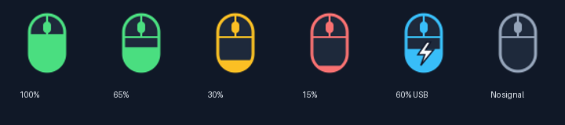

# Monster Pusat için Mouse Battery

Compx **`260d:1074` 2.4 GHz USB alıcısı** kullanan bir Monster Pusat mouse için
Linux pil okuyucusu ve masaüstü göstergesi.

[English / ayrıntılı README](README.md) · [Protokol](docs/protocol.md) · [Katkı rehberi](CONTRIBUTING.md)



## Ne yapar?

- Üst barda pil yüzdesi ve doluluğu değişen fare ikonu gösterir.
- Normal seviyede yeşil, %20–39 arasında sarı, %20 altında kırmızıdır.
- Kablo bağlı bayrağında mavi fare ve şimşek; ölçüm yoksa gri fare ve `—` gösterir.
- Her 5 saniyede arka planda ölçüm yapar; arayüzü USB yanıtı için bekletmez.
- Menüde bağlantı türü, son ölçüm saati, yenileme ve kapatma seçenekleri bulunur.
- Kablo bağlı değilken %20 altında en fazla 10 dakikada bir bildirim gönderir.

Bu bağımsız bir topluluk projesidir; resmi Monster yazılımı değildir.
GNOME Ayarlar / UPower pil listesine aygıt eklemez.

## Hangi sistemlerde çalışır?

**Gerçek cihazla doğrulanan ortam: Ubuntu 26.04.1 LTS, GNOME, x86_64,
Python 3.14.4 ve `260d:1074` alıcılı bir Monster Pusat mouse.**
Kesin ticari model adı ve firmware sürümü henüz kaydedilmedi.

| Ortam | Durum |
| --- | --- |
| Yukarıdaki Ubuntu ve donanım | Pil okuma ve gösterge doğrulandı |
| Diğer Ubuntu sürümleri / Debian tabanlı dağıtımlar | Henüz test edilmedi; kurulum betiği apt-get ve udev gerektirir |
| Fedora, Arch, openSUSE vb. | Henüz test edilmedi; elle bağımlılık ve izin kurulumu gerekir |
| Diğer masaüstleri | Henüz test edilmedi; AppIndicator / StatusNotifier desteği gerekir |
| Başka mimariler | Henüz test edilmedi; HID ioctl sabitleri doğrulanmalıdır |
| Bluetooth, farklı USB kimliği ve diğer Pusat modelleri | Mevcut cihaz bulma kodu desteklemiyor |
| Windows / macOS | Desteklenmiyor |

**“Her Linux dağıtımında çalışır” iddiası yoktur.** Terminal okuyucusu Linux
hidraw ve sysfs arayüzlerini kullanır. Gösterge ayrıca GTK 3, PyGObject,
Ayatana AppIndicator ve masaüstünün sistem tepsisi desteğine bağlıdır.
GNOME'da AppIndicator uzantısı etkin olmalıdır.

## Ubuntu kurulumu

Repo klasöründe, normal masaüstü kullanıcınızın terminalinden:

```bash
sudo bash install.sh
/usr/bin/python3 mouse_tray.py
```

Betik bağımlılıkları ve alıcıya özel udev kuralını kurar, sudo çağıran
kullanıcının oturum başlangıcına uygulamayı ekler. GNOME uzantısını kurmaz.
Gerekirse alıcıyı çıkarıp yeniden takın. Uygulamayı root olarak çalıştırmayın.
Repo klasörünü taşırsanız otomatik başlatma yolu değişeceği için kurulumu tekrarlayın.

Uygulama `.env`, root parolası veya ağ servisi kullanmaz. Gösterge için dağıtımın
`gi` paketini gören sistem Python'unu kullanın. Kod Python 3.9+ gerektirir;
yukarıdaki sürüm dışındakiler yerel olarak doğrulanmadı.

Diğer dağıtımlarda gerekli bağımlılıklar, udev/logind izinleri ve elle otomatik
başlatma için [İngilizce kurulum bölümüne](README.md#other-linux-distributions-manual-setup) bakın.

## Terminalden kullanım

```bash
python3 mouse_battery.py
python3 mouse_battery.py --raw
python3 mouse_battery.py --watch 5
```

Terminal okuyucusu GTK gerektirmez; Python standart kütüphanesi yeterlidir.
Kablo durumu sonraki başarılı okumada, normalde yaklaşık beş saniye ve sorgu
süresi içinde güncellenir. Şimşek **kablo bağlı** demektir; tek başına aktif şarjı
kanıtlamaz. Aynı bağlantı türünde büyük yüzde değişimleri üç saniye sonra bir ek
okumayla kontrol edilir. Bağlantı hatasında eski yüzde yerine `—` gösterilir.

## Bilinen cihaz davranışı

Test edilen cihaz kablo takılıyken **%95**, kablo çıkarılmışken **%100** bildirdi.
Tekrarlı ölçümlerde iki yanıt da sabit kaldı ve checksum'ları geçerliydi.
Yazılım bu değerleri tahmini bir düzeltme uygulamadan gösterir. Voltaj alanı sıfır
olduğu için gerçek doluluğu bağımsız olarak belirlemek mümkün olmadı.

Ham yanıtlar [protokol belgesinde](docs/protocol.md) bulunur. Kablo çıkarılması
gerçek cihazda izlendi; USB alıcının farklı hidraw numarasıyla geri gelmesi ise
sahte aygıt testleriyle kontrol edildi.

## Sorun giderme

- **Alıcı bulunamadı:** USB kimliğinin `260d:1074` olduğunu ve alıcının bağlı olduğunu kontrol edin.
- **Erişim izni yok:** udev kuralını kurun, alıcıyı yeniden takın ve aktif yerel masaüstü oturumu kullanın.
- **Yanıt yok:** mouse'u açın/uyandırın ve menüden “Şimdi yenile” seçeneğine basın.
- **`gi` veya namespace hatası:** sistem bağımlılıklarını kurup sistem Python'unu kullanın.
- **Gösterge görünmüyor:** masaüstünde AppIndicator / StatusNotifier desteğini etkinleştirin.

Hata çıktısı için çalışan göstergeyi menüden kapatıp terminalde
`/usr/bin/python3 mouse_tray.py` çalıştırın.

## Testler

Gösterge bağımlılıkları kurulduktan sonra:

```bash
/usr/bin/python3 -m unittest discover -s tests -v
bash -n install.sh
```

Testler USB erişimini taklit eder; fare, root ve grafik oturumu gerekmez.
GitHub Actions aynı kontrolleri Ubuntu ortamlarında çalıştıracak şekilde
hazırlanmıştır; başarılı CI sonucu donanım veya dağıtım uyumluluğunu kanıtlamaz.

## Kaldırma

Menüden Kapat seçeneğine basın, ardından:

```bash
rm -f ~/.config/autostart/mouse-battery-indicator.desktop
sudo rm -f /etc/udev/rules.d/70-mouse-battery.rules
sudo rm -f /etc/udev/rules.d/99-mouse-battery.rules
sudo udevadm control --reload-rules
```

Alıcıyı yeniden takın. İsteğe bağlı olarak varsayılan ikon önbelleği
`~/.cache/mouse-battery/` silinebilir. Ortak sistem bağımlılıkları kaldırılmaz.

## Kaynak ve lisans

İlk yerel uygulama protokol için [Fan4Metal/mouse_tray](https://github.com/Fan4Metal/mouse_tray)
projesini referans göstermiştir. Bu repo [MIT lisansı](LICENSE) ile sunulur.
Monster ve Pusat adları donanımı tanımlamak için kullanılır.
